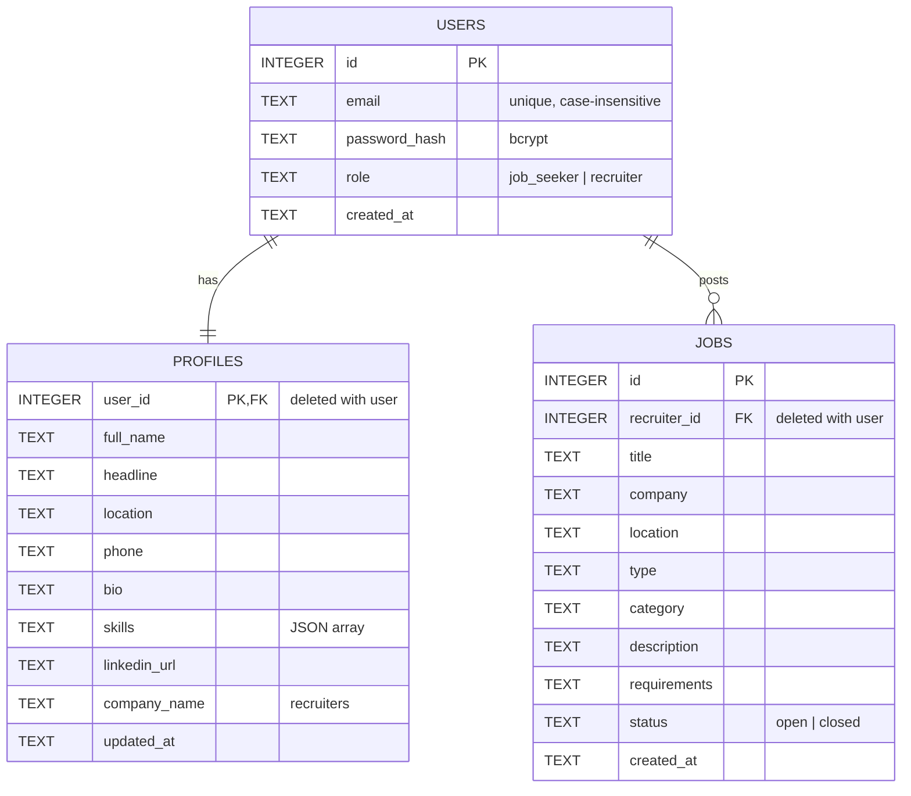

# Database schema

SQLite, created automatically by `server/src/db.js` on first start (`CREATE TABLE IF NOT EXISTS`).



Design notes:
- One profile per user, created in the same transaction as the account, so a user never exists without a profile.
- `email` uses `COLLATE NOCASE` so `Sam@x.com` and `sam@x.com` are the same account.
- `role` is limited by a `CHECK` constraint to the two supported user types.
- Passwords are stored only as bcrypt hashes.
- The `resumes` table is added by US-04.

- The `jobs` table supports US-06 / Task 6.1. `recruiter_id` references the posting owner's user ID; future posting-management routes must enforce the recruiter role.
- Jobs default to `open`; closing a posting keeps its record while removing it from the public listing.
- `type` and `category` are text fields for the later search/filter tasks. `requirements` is plain text.
- Existing databases gain the table on startup without deleting users, profiles, or resumes. No sample jobs are inserted automatically.

## Available jobs API

`GET /api/jobs` is public and returns HTTP 200 with `{ "jobs": [...] }`.
Only open postings appear, ordered by `created_at` descending, then `id` descending
for consistent ordering when timestamps match. No postings returns `{ "jobs": [] }`.
Each job has `id`, `title`, `company`, `location`, `type`, `category`, `description`,
`requirements`, and `created_at` (SQLite UTC timestamp, `YYYY-MM-DD HH:MM:SS`).
The recruiter owner's ID and internal posting status are not included.

Example response:

```json
{
  "jobs": [
    {
      "id": 1,
      "title": "Software Developer",
      "company": "Example Company",
      "location": "Montreal",
      "type": "Full-time",
      "category": "Engineering",
      "description": "Build web applications.",
      "requirements": "Experience with JavaScript.",
      "created_at": "2026-10-22 12:00:00"
    }
  ]
}
```

### Keyword search

`GET /api/jobs?q=developer` searches the title, company, and description of open
postings. Matching uses a literal, case-insensitive substring after trimming
leading and trailing whitespace. `%`, `_`, and quotes are treated as ordinary
characters. Search terms are not inserted into SQL.

Missing, empty, or whitespace-only `q` returns all open postings. No matches
returns HTTP 200 with `{ "jobs": [] }`. Search preserves the public response
fields and newest-first ordering. Repeated `q` parameters return HTTP 400 with
`{ "error": "Search keyword must be a single string." }`.

Search currently filters the open-posting list in application code using
JavaScript lowercase matching, including accented case pairs. Pagination and
database search indexing can be added if the list grows.

Job creation/editing, a dedicated details endpoint, and location/category filters
are separate tasks. To validate the backend, run `npm test` in `server/`;
`server/tests/jobs.test.js` inserts fixtures into an isolated in-memory database
and exercises the HTTP endpoint. A fresh development database returns an empty
list until postings are added by a future posting-management feature or manually.
