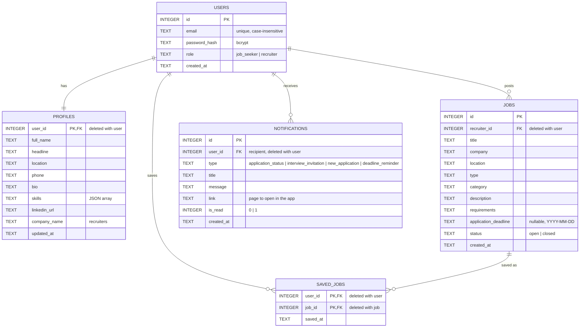

# Database schema

SQLite, created automatically by `server/src/db.js` on first start (`CREATE TABLE IF NOT EXISTS`).



Design notes:
- One profile per user, created in the same transaction as the account, so a user never exists without a profile.
- `email` uses `COLLATE NOCASE` so `Sam@x.com` and `sam@x.com` are the same account.
- `role` is limited by a `CHECK` constraint to the two supported user types.
- Passwords are stored only as bcrypt hashes.
- The `resumes` table is added by US-04.

- The `jobs` table supports US-06 / Task 6.1. `recruiter_id` references the posting owner's user ID; future posting-management routes must enforce the recruiter role.
- Jobs default to `open`; closing a posting keeps its record while removing it from the public listing.
- `type` and `category` are text fields for the later search/filter tasks. `requirements` is plain text.
- Existing databases gain the table on startup without deleting users, profiles, or resumes. No sample jobs are inserted automatically.

- The `saved_jobs` table supports US-09 / Task 9.1. Its primary key is (`user_id`, `job_id`), so a job can only be saved once per user.
- Saved rows are deleted automatically (`ON DELETE CASCADE`) when the user or the job is deleted. Existing databases gain the table on startup.

## Available jobs API

`GET /api/jobs` is public and returns HTTP 200 with `{ "jobs": [...] }`.
Only open postings appear, ordered by `created_at` descending, then `id` descending
for consistent ordering when timestamps match. No postings returns `{ "jobs": [] }`.
Each job has `id`, `title`, `company`, `location`, `type`, `category`, `description`,
`requirements`, and `created_at` (SQLite UTC timestamp, `YYYY-MM-DD HH:MM:SS`).
The recruiter owner's ID and internal posting status are not included.

Example response:

```json
{
  "jobs": [
    {
      "id": 1,
      "title": "Software Developer",
      "company": "Example Company",
      "location": "Montreal",
      "type": "Full-time",
      "category": "Engineering",
      "description": "Build web applications.",
      "requirements": "Experience with JavaScript.",
      "created_at": "2026-10-22 12:00:00"
    }
  ]
}
```

### Keyword search

`GET /api/jobs?q=developer` searches the title, company, and description of open
postings. Matching uses a literal, case-insensitive substring after trimming
leading and trailing whitespace. `%`, `_`, and quotes are treated as ordinary
characters. Search terms are not inserted into SQL.

Missing, empty, or whitespace-only `q` returns all open postings. No matches
returns HTTP 200 with `{ "jobs": [] }`. Search preserves the public response
fields and newest-first ordering. Repeated `q` parameters return HTTP 400 with
`{ "error": "Search keyword must be a single string." }`.

Search currently filters the open-posting list in application code using
JavaScript lowercase matching, including accented case pairs. Pagination and
database search indexing can be added if the list grows.

Job creation/editing, a dedicated details endpoint, and location/category filters
are separate tasks. To validate the backend, run `npm test` in `server/`;
`server/tests/jobs.test.js` inserts fixtures into an isolated in-memory database
and exercises the HTTP endpoint. A fresh development database returns an empty
list until postings are added by a future posting-management feature or manually.

## Saved jobs API

US-09 / Task 9.2. All routes require a `Bearer` token (HTTP 401 without one) and
are limited to job seekers (recruiters get HTTP 403).

| Method | Route | Result |
| --- | --- | --- |
| `POST` | `/api/saved-jobs/:jobId` | 201 when saved, 200 if it was already saved (no duplicate row) |
| `DELETE` | `/api/saved-jobs/:jobId` | 204 when removed, 404 if it was not saved |
| `GET` | `/api/saved-jobs` | 200 with `{ "savedJobs": [...] }`, newest save first |

Invalid job IDs return HTTP 400. Only open jobs can be saved (HTTP 404 otherwise),
and closed jobs are left out of the list. Each saved job has the same fields as
`GET /api/jobs` plus `savedAt`. Tests are in `server/tests/saved-jobs.test.js`.

## Notifications

US-16 / Task 16.1. The `notifications` table stores in-app notifications; `user_id` is the
recipient. Rows are deleted with the user (`ON DELETE CASCADE`). `type` is limited by a
`CHECK` constraint to the four supported types, and `is_read` is `0` or `1`. An index on
(`user_id`, `is_read`, `created_at`) keeps the list and unread count fast. A partial unique
index on (`user_id`, `link`) for `deadline_reminder` rows makes sure a job seeker is reminded
about each saved job only once, even after dismissing the reminder. Existing databases gain
the table on startup.

Notifications are created by the server (Task 16.3, `server/src/notifications.js`):

| Event | Recipient | Type |
| --- | --- | --- |
| A job seeker applies to a posting | The recruiter who owns it | `new_application` |
| A recruiter changes an application's status | The applicant | `application_status` |
| The new status is `Interview` | The applicant | `interview_invitation` |
| A saved open job's deadline is within 3 days | The job seeker | `deadline_reminder` |

Saving the same status again sends nothing. There is no background scheduler, so deadline
reminders are created when the job seeker next loads their notifications or unread count.

### Notifications API

Task 16.2. All routes require a `Bearer` token (HTTP 401 without one) and only touch the
signed-in user's own notifications.

| Method | Route | Result |
| --- | --- | --- |
| `GET` | `/api/notifications` | 200 with `{ "notifications": [...], "unreadCount": n }`, newest first |
| `GET` | `/api/notifications/unread-count` | 200 with `{ "unreadCount": n }` |
| `PATCH` | `/api/notifications/:id/read` | 200 with the updated notification and unread count |
| `POST` | `/api/notifications/read-all` | 200 with `{ "updated": n, "unreadCount": 0 }` |
| `DELETE` | `/api/notifications/:id` | 204 when dismissed |

Each notification has `id`, `type`, `title`, `message`, `link`, `isRead` (boolean) and
`createdAt`. A malformed ID returns HTTP 400; a missing notification, or one that belongs
to another user, returns HTTP 404. Tests are in `server/tests/notifications.test.js`.
